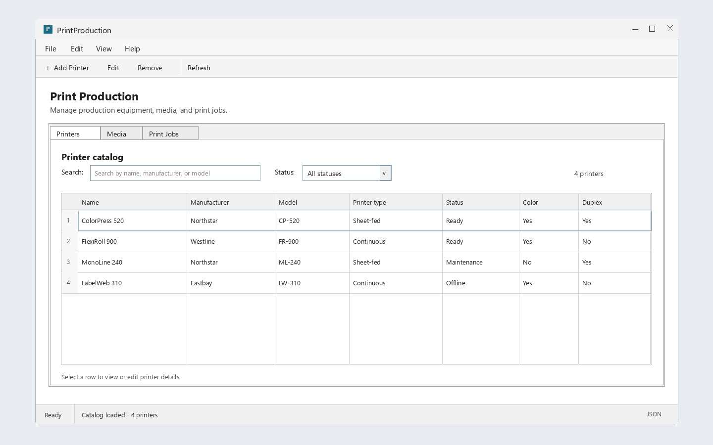

# PrintProduction — Internship Worksheet

**Day 7: WinForms Project and Application Shell**

---

## 1. Today's learning objectives

The domain and JSON persistence are separate from any user interface. Today you will create a Windows Forms application that references those layers and begin a usable desktop experience.

By the end of the day, you should be able to:

- Explain why the WinForms project is separate from the domain library.
- Create and configure a `PrintProduction.WinForms` project.
- Reference the domain and persistence projects from the UI.
- Build a main form with clear navigation and a printer catalog view.
- Load catalog data without placing catalog rules in the form.
- Use Visual Studio's WinForms designer or code-based controls consistently.

Today's work addresses the initial setup for optional requirement F11.

### UI proposal

Use this concept as a visual guide for a conventional WinForms application, using a MenuStrip, ToolStrip, TabControl, standard search and filter controls, a DataGridView, and a StatusStrip. The tabs switch between Printers, Media and Print Jobs. The sample printer records are illustrative. Treat the mockup as a starting point rather than a requirement to reproduce every visual detail.



## 2. Exercise 1 — Set up Visual Studio and create the WinForms project

**Estimated time: 60 minutes**

### Task 1.1 — Install Visual Studio Community

If Visual Studio is not installed:

1. Download and run the Visual Studio Community installer from the [Visual Studio downloads page](https://visualstudio.microsoft.com/downloads/).
2. In the Workloads tab, select **.NET desktop development**. This installs the Windows Forms tools and designer.
3. Install Visual Studio. If the installer offers individual components for a .NET SDK or targeting pack, make sure .NET 10 support is included. The existing projects target `net10.0`.
4. Launch Visual Studio when setup completes.

If Visual Studio is already installed, open **Visual Studio Installer**, select **Modify** for your installation, and add the **.NET desktop development** workload if it is not selected. If .NET 10 is not available as a target framework when creating the project, update Visual Studio and install the .NET 10 SDK.

### Task 1.2 — Open the existing solution

1. In Visual Studio, select **File > Open > Project/Solution**.
2. Browse to the repository folder and open `PrintProduction.sln`.
3. In **Solution Explorer**, confirm that the existing Domain and Playground projects are listed. If Solution Explorer is hidden, open it from **View > Solution Explorer**.

Open the solution file, not an individual `.cs` file or project, so the new UI project can be added alongside the existing projects.

### Task 1.3 — Create and add the Windows Forms project

1. In **Solution Explorer**, right-click the `PrintProduction` solution and select **Add > New Project**.
2. Search for `Windows Forms App`. Choose the C# **Windows Forms App** template. Do **not** choose **Windows Forms App (.NET Framework)**.
3. Set the project name to `PrintProduction.WinForms`. Set its location to the repository folder so the project is alongside the existing project folders.
4. Select **Next**. Set the framework to **.NET 10.0** (the same target as the existing projects), then select **Create**.
5. Confirm that `PrintProduction.WinForms` now appears under the solution in Solution Explorer and that the template created a form, such as `Form1`.

If .NET 10.0 is missing from the framework list, stop and install the .NET 10 SDK and matching Visual Studio support before choosing a different target. Keep the projects on compatible target frameworks.

### Task 1.4 — Add project references

The WinForms project should reference:

- `PrintProduction.Domain`
- `PrintProduction.Persistence`

To add each reference, right-click **Dependencies** under `PrintProduction.WinForms`, select **Add Project Reference**, check the project, and select **OK**. If **Dependencies** is not shown, right-click the WinForms project itself and choose **Add > Project Reference**.

The Domain project must not reference either application project. Keep the UI dependent on the domain and persistence layers, not the other way around.

### Task 1.5 — Verify project setup

In Visual Studio, select **Build > Build Solution** (or press **Ctrl+Shift+B**). Resolve any target-framework or project-reference issues before adding UI behavior. Confirm the WinForms project has Windows Forms enabled and that its startup form opens when you press **F5**.

## 3. Exercise 2 — Create the main application shell

**Estimated time: 90 minutes**

### Task 2.1 — Design the main form

Create a main window with:

- A clear application title.
- Simple navigation for Printers, Media and Print Jobs.
- A central content area for the selected view.
- A status area for load/save results and validation feedback.

Keep navigation predictable and controls clearly labeled. Do not build a complex dashboard or production-planning workflow today.

### Task 2.2 — Add the printer catalog view

Create the first printer view and display catalog entries in a `DataGridView`, as required by F11. Show useful identifying and capability fields, such as name, manufacturer, model, type, status, color and duplex support.

Load data through the persistence layer and present it through the UI. Do not implement serialization, compatibility rules or catalog operations inside event handlers.

### Task 2.3 — Handle startup states

Make the UI distinguish a first run with no saved catalog from a load failure. Show a useful message when data cannot be loaded; do not silently display an empty catalog after a persistence error.

## 4. Exercise 3 — Check usability and layer boundaries

**Estimated time: 60 minutes**

Run the application and check that:

1. The main window opens and navigation works.
2. The printer grid has readable column names and does not expose internal implementation details.
3. Empty data is presented clearly.
4. Load failures are visible and understandable.
5. Forms call domain/persistence operations rather than duplicating their logic.

Ask a peer or mentor to try locating the printer list and explain what each visible field means. Improve any confusing labels.

## 5. Exercise 4 — Verify, review and document

**Estimated time: 45 minutes**

Run:

```bash
dotnet build PrintProduction.sln
dotnet run --project PrintProduction.WinForms/PrintProduction.WinForms.csproj
```

Review the changed files, commit with a message such as `Create WinForms application shell`, and update README.md with the UI project's purpose and launch command.

## 6. Final reflection

1. Why does `PrintProduction.Domain` remain independent of WinForms?
2. What should the user see when there are no printer records?
3. Which UI details made the catalog easiest to understand?

## 7. Completion checklist

- [ ] Added `PrintProduction.WinForms` to the solution.
- [ ] Added references from the UI to Domain and Persistence only.
- [ ] Created a main form with working navigation.
- [ ] Displayed printers in a `DataGridView`.
- [ ] Distinguished empty catalog state from load failure.
- [ ] Built and launched the WinForms application.
- [ ] Updated README.md and committed the work.

## 8. Looking ahead — Day 8

Tomorrow you will make the printer view useful by adding printer creation, editing, deletion and validation.

## 9. Learning resources

- [Download Visual Studio](https://visualstudio.microsoft.com/downloads/)
- [Install Visual Studio workloads](https://learn.microsoft.com/en-us/visualstudio/install/modify-visual-studio?view=vs-2022)
- [Windows Forms overview](https://learn.microsoft.com/en-us/dotnet/desktop/winforms/overview/)
- [DataGridView control overview](https://learn.microsoft.com/en-us/dotnet/desktop/winforms/controls/datagridview-control-overview-windows-forms)
